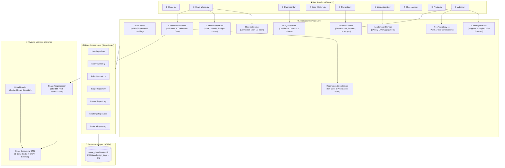
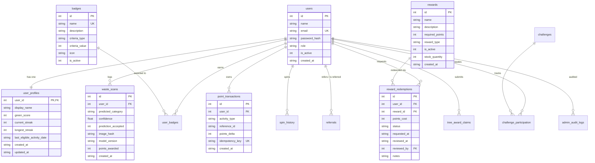

<<<<<<< HEAD
# ♻️ RightBin — "Wet or Dry, Always Right." - Smart Waste Classification System Using CNN, Personal Green Score and Gamification

An integrated, end-to-end, runnable web application designed for campus and municipal automated waste sorting, environmental habit tracking, and eco-incentivization.

Built with **Python**, **Streamlit**, **TensorFlow/Keras**, and **SQLite**.

---

## 📑 Table of Contents
1. [Project Overview](#-project-overview)
2. [System Architecture Diagram](#-system-architecture-diagram)
3. [Database Entity-Relationship (ER) Diagram](#-database-entity-relationship-er-diagram)
4. [Project Directory Structure](#-project-directory-structure)
5. [Installation & Setup](#-installation--setup)
6. [Dataset Acquisition & Preparation](#-dataset-acquisition--preparation)
7. [CNN Training & Evaluation](#-cnn-training--evaluation)
8. [Database Initialization & Seeding](#-database-initialization--seeding)
9. [Running the Application](#-running-the-application)
10. [Demo Accounts](#-demo-accounts)
11. [Running Automated Tests](#-running-automated-tests)
12. [Manual Demonstration Checklist](#-manual-demonstration-checklist)
13. [Viva Explanations Guide (2nd Year CS Level)](#-viva-explanations-guide-second-year-cs-level)
14. [Security & Data Integrity](#-security--data-integrity)
15. [Limitations & Future Scope](#-limitations--future-scope)

---

## 🌟 Project Overview

Improper waste segregation is one of the leading bottlenecks in recycling supply chains. Standard recycling bins frequently become contaminated when non-recyclables or greasy items are mixed with clean paper and plastics.

The **Smart Waste Classification System** solves this by combining:
1. **Computer Vision (TensorFlow/Keras CNN)**: Classifies waste into 5 classes: **Plastic**, **Paper**, **Organic**, **Metal**, and **Glass**, while rejecting blurry or ambiguous inputs below a configurable confidence threshold (60%).
2. **Actionable Recommendations**: Instant municipal bin guidance, item preparation steps (rinsing, crushing), and contamination warnings.
3. **Personal Green Score & Daily Streaks**: Promotes habit formation by awarding Green Points for valid scans and consecutive daily recycling streaks.
4. **Authoritative Ledger & Rewards**: Points are logged in an append-only transaction ledger with idempotency keys. Users redeem points for vouchers, sustainable living kits, and Plant-a-Tree certificates.
5. **Community Engagement**: Weekly leaderboards with documented tie-breakers, friendly referrals, and eco-sprints.

---

## 🏛️ System Architecture Diagram



---

## 🗄️ Database Entity-Relationship (ER) Diagram



---

## 📁 Project Directory Structure

```
smart-waste-classification/
|-- app.py                        # Streamlit main entrypoint
|-- config.py                     # Centralized application settings & thresholds
|-- requirements.txt              # Production and testing dependencies
|-- README.md                     # Comprehensive project documentation
|-- .env.example                  # Template configuration environment file
|-- .gitignore                    # Git exclusions (caches, weights, DB)
|
|-- pages/                        # Multi-page application structure
|   |-- 1_Home.py                 # System overview and mission
|   |-- 2_Scan_Waste.py           # Real-time waste scanning & classification
|   |-- 3_Dashboard.py            # Personal eco metrics & Plotly charts
|   |-- 4_Scan_History.py         # Full scan audit log with CSV export
|   |-- 5_Rewards.py              # Reward catalogue, redemption & Lucky Spin
|   |-- 6_Leaderboard.py          # Weekly community leaderboard
|   |-- 7_Challenges.py           # Active eco-challenges & progress
|   |-- 8_Profile.py              # Profile, referral code & Plant-a-Tree claims
|   |-- 9_Admin.py                # Admin control center & ML audit
|
|-- components/                   # Reusable UI modules
|   |-- navigation.py             # Sidebar, session management & auth guards
|   |-- metric_cards.py           # Green Score, balance, streaks & levels
|   |-- badge_cards.py            # Visual achievements grid
|   |-- reward_cards.py           # Reward inventory cards
|   |-- charts.py                 # Plotly donut & bar charts
|   |-- messages.py               # Celebration banners & notifications
|
|-- services/                     # Business logic layer
|   |-- auth_service.py           # Registration, login & PBKDF2 hashing
|   |-- classification_service.py # Image validation, CNN inference, confidence gate
|   |-- recommendation_service.py # Disposal instructions & contamination warnings
|   |-- gamification_service.py   # Green Score, streaks, badges, levels
|   |-- rewards_service.py        # Redemption reservations, refunds, Lucky Spin
|   |-- leaderboard_service.py    # Weekly point aggregations & tie-breakers
|   |-- challenge_service.py      # Sprints & bonus awards
|   |-- referral_service.py       # Referral codes & verification bonuses
|   |-- tree_award_service.py     # Plant-a-Tree milestone tracking
|   |-- analytics_service.py      # Dashboard contract & data aggregates
|
|-- repositories/                 # Data access layer (Parameterized SQL)
|   |-- user_repository.py        # Users and user_profiles queries
|   |-- scan_repository.py        # waste_scans and duplicate checks
|   |-- points_repository.py      # point_transactions ledger & balances
|   |-- badge_repository.py       # badges and user_badges queries
|   |-- reward_repository.py      # rewards, redemptions & spin history
|   |-- challenge_repository.py   # challenges & challenge_participation
|   |-- referral_repository.py    # referrals & tree_award_claims
|
|-- database/                     # SQLite persistence
|   |-- connection.py             # Context manager enforcing PRAGMA foreign_keys = ON
|   |-- schema.sql                # Complete relational schema DDL
|   |-- init_db.py                # Database initialization & default seeding
|   |-- migrations/               # Versioned migration directory
|
|-- ml/                           # ML inference and model metadata
|   |-- model_loader.py           # Cached model loader with singleton lock
|   |-- predictor.py              # Inference pipeline & threshold logic
|   |-- preprocessing.py          # Unified image resizing & normalization
|   |-- class_labels.json         # Authoritative 5 waste categories
|   |-- model_metadata.json       # Version, test accuracy, per-class metrics
|   |-- artifacts/                # Saved .keras weights & evaluation plots
|
|-- training/                     # CNN training and evaluation scripts
|   |-- prepare_dataset.py        # Prepares balanced 5-class dataset splits
|   |-- train_model.py            # Keras CNN training with EarlyStopping
|   |-- evaluate_model.py         # Test split evaluation, confusion matrix & curves
|
|-- data/                         # Persistent database & image dataset
|   |-- README.md                 # Dataset documentation
|
|-- utils/                        # Core utilities
|   |-- validators.py             # Email, password, file size & image format checks
|   |-- security.py               # PBKDF2 hashing & SHA-256 image hashes
|   |-- time_utils.py             # UTC timestamps, streak dates & week boundaries
|   |-- logging_config.py         # Formatted application logger
|
|-- tests/                        # Automated pytest suite
|   |-- conftest.py               # In-memory DB fixtures & test users
|   |-- test_auth.py              # Auth & session security tests
|   |-- test_classification.py    # Preprocessing & inference tests
|   |-- test_scoring.py           # Gamification & streak tests
|   |-- test_rewards.py           # Redemption transactions & refund tests
|   |-- test_leaderboard.py       # Weekly rankings & privacy tests
|   |-- test_database.py          # Foreign keys, constraints & idempotency
|
|-- assets/                       # Static media & CSS
|   |-- logo.png                  # System logo
|   |-- styles.css                # Eco UI styling
|
|-- scripts/                      # CLI operations
|   |-- create_admin.py           # Admin creation/reset CLI
|   |-- check_environment.py      # Diagnostic health check
```

---

## 🚀 Installation & Setup

### Prerequisites
- Python 3.10 to 3.13
- Git

### 1. Clone & Enter Directory
=======
# ♻️ Smart Waste Classification

An AI-powered waste classification system that uses Machine Learning and Computer Vision to identify and classify different types of waste. The project aims to encourage proper waste segregation, improve recycling practices, and support sustainable waste management.

## 📌 Project Overview

Smart Waste Classification is a machine learning-based application designed to automatically identify waste categories from uploaded images.

The system helps users understand how to segregate waste efficiently by classifying waste images and providing an organized interface for interacting with the classification system.

## ✨ Features

- **Waste Image Classification:** Identifies waste categories using a trained machine learning model.
- **Interactive Dashboard:** Provides a user-friendly dashboard to access application features.
- **Image Upload:** Allows users to upload waste images for classification.
- **Rewards System:** Includes a rewards page to encourage responsible waste management.
- **Database Integration:** Stores relevant application data.
- **Modular Architecture:** Organized into separate components, services, repositories, and utility modules.

## 🛠️ Technologies Used

- **Programming Language:** Python
- **Frontend:** Streamlit (if used in your application)
- **Machine Learning:** Python-based ML frameworks
- **Database:** Project-configured database
- **Version Control:** Git and GitHub

## 📂 Project Structure

```text
smart-waste-classification/
│
├── app.py
├── config.py
├── requirements.txt
├── README.md
│
├── assets/
├── components/
├── data/
├── database/
├── ml/
├── pages/
├── repositories/
├── scripts/
├── services/
├── tests/
├── training/
└── utils/
```

## ⚙️ Installation and Setup

### 1. Clone the Repository

```bash
git clone https://github.com/YOUR_USERNAME/smart-waste-classification.git
```

### 2. Navigate to the Project Directory

>>>>>>> 7deff6d86e469883358a1a52404903cbdf899b2b
```bash
cd smart-waste-classification
```

<<<<<<< HEAD
### 2. Create Virtual Environment
```bash
python3 -m venv .venv
source .venv/bin/activate    # On Windows: .venv\Scripts\activate
```

### 3. Install Dependencies
```bash
pip install --upgrade pip
pip install -r requirements.txt
```

---

## 🖼️ Dataset Acquisition & Preparation

The system supports five categories: `Plastic`, `Paper`, `Organic`, `Metal`, `Glass`.

To prepare the dataset splits (Train: 70%, Validation: 15%, Test: 15%):
```bash
python training/prepare_dataset.py
```
This generates balanced items in `data/dataset/`. To ingest real-world datasets such as **TrashNet** or **Kaggle Waste Classification**, simply place corresponding images inside `data/dataset/train/<Category>/` and `data/dataset/val/<Category>/`.

---

## 🧠 CNN Training & Evaluation

Train the genuine Keras CNN model on the dataset:
```bash
python training/train_model.py
```
This compiles the CNN, trains for up to 15 epochs with `EarlyStopping(patience=4)` and `ModelCheckpoint`, saves the best model to `ml/artifacts/waste_classifier.keras`, and outputs accuracy/loss curves to `ml/artifacts/training_history.png`.

Evaluate the model on the held-out test split:
```bash
python training/evaluate_model.py
```
This evaluates test accuracy, prints the classification report (precision, recall, f1-score per class), generates `ml/artifacts/confusion_matrix.png`, and writes `ml/artifacts/model_metadata.json`.

---

## 🗃️ Database Initialization & Seeding

Initialize the SQLite database schema and seed levels, badges, rewards, challenges, and default admin:
```bash
python database/init_db.py
```

Run the diagnostic health check to verify everything is in order:
```bash
python scripts/check_environment.py
```

---

## 💻 Running the Application

Launch the Streamlit web interface:
```bash
streamlit run app.py
```
Open your browser and navigate to:
```
http://localhost:8501
```

---

## 📱 Mobile Phone & Multi-Device Scanning

The system is configured to bind to `0.0.0.0:8501`, enabling real-time scanning from any smartphone, tablet, or external laptop on the same Wi-Fi/LAN:

1. **Find Network Address**: Look at the QR code and URL displayed in the app header (e.g. `http://192.168.1.36:8501`).
2. **Scan the QR Code**: Open your phone camera (iOS Camera or Android Google Lens) and scan the QR code to open the web app instantly.
3. **Live Mobile Camera**:
   - Go to **2. Scan Waste**.
   - Select **📷 Live Camera Capture**.
   - Point your phone camera directly at the trash item (bottle, paper cup, apple peel, can, etc.) and tap capture.
4. **Touch-Friendly UI**: The layout automatically adjusts on mobile screens with stacked viewports, enlarged touch buttons, and responsive Plotly charts.

---

## 🔑 Demo Accounts

The database comes pre-seeded with administrator and user accounts:

| Role | Email Address | Password | Privileges |
| :--- | :--- | :--- | :--- |
| **System Admin** | `admin@smartwaste.org` | `AdminPassword123!` | Full Admin Panel, Review Redemptions, Audit Trees, Publish Challenges |
| **Super Admin** | `super@smartwaste.org` | `SuperAdminPass123!` | Administrator Privileges |
| **New Users** | *Register in UI* | *Min 8 characters* | Scan Waste, Earn Points, Redeem Rewards, Leaderboard |

To create or reset an administrator account from the CLI:
```bash
python scripts/create_admin.py "Custom Admin" "myadmin@smartwaste.org" "SecurePassword123!"
```

---

## 🧪 Running Automated Tests

Run the complete test suite with **pytest**:
```bash
pytest tests/ -v
```

All 22 automated tests verify:
- ✅ Password hashing & authentication security
- ✅ Role authorization guards
- ✅ CNN preprocessing & output formatting
- ✅ Confidence threshold decision gating
- ✅ SQLite foreign key enforcement
- ✅ Points ledger idempotency & balance consistency
- ✅ Streak continuity & daily reset calculations
- ✅ Rewards reservation, stock decrement, and rejection refunds
- ✅ Weekly leaderboard tie-breaking and privacy safety

---

## 📋 Manual Demonstration Checklist

Follow this workflow for live demonstrations and project assessments:

1. **System Health**:
   - Run `python scripts/check_environment.py`. Verify all 12 tables and model artifacts show `[+] OK`.
2. **Account Registration**:
   - Open browser at `http://localhost:8501`.
   - Register a new account (e.g. `student@university.edu`).
3. **First Waste Scan**:
   - Navigate to **2. Scan Waste**.
   - Upload a sample waste image (e.g., from `data/dataset/test/Plastic/`).
   - Observe: Model confidence gauge, predicted class (`Plastic`), disposal instructions (Blue Bin, rinsing steps), and confetti animation.
   - Points earned: **+10 pts** (classification) + **+5 pts** (first scan of the day) = **+15 pts**.
   - Achievement unlocked: **Recycling Rookie** badge!
4. **Duplicate Prevention**:
   - Upload the exact same image again.
   - Observe: System identifies matching SHA-256 hash. Status displays **+0 points** (duplicate scan protection).
5. **Dashboard Analytics**:
   - Navigate to **3. Dashboard**.
   - Observe updated Green Score (+15), active streak (1 Day), category breakdown donut chart, and 7-day activity bar.
6. **Lucky Scan Spin**:
   - Navigate to **5. Rewards** -> **🎡 Lucky Scan Spin**.
   - Click "Spin the Wheel!". Receive server-side random bonus (+5 to +25 pts).
   - Try spinning immediately again: observe 24-hour cooldown restriction.
7. **Rewards Redemption**:
   - View catalogue. If balance >= 500, request the **Eco Cotton Tote Bag**.
   - Observe: Points reserved immediately (-500 pts), stock decrements, and status enters **Pending Review**.
8. **Admin Review**:
   - Sign in as `admin@smartwaste.org`.
   - Navigate to **9. Admin** -> **Review Redemptions**.
   - Approve or Reject the redemption. On rejection, observe that reserved points are automatically refunded to the user's ledger!
   - Review the **ML Model & Audit** tab to inspect the confusion matrix and per-class metrics.

---

## 🎓 Viva Explanations Guide (Second Year CS Level)

Use these concise explanations during oral viva examinations:

### 1. How does the Convolutional Neural Network (CNN) classify waste?
> *"Our CNN consists of three convolutional blocks followed by Max Pooling. Each convolution layer applies 3x3 learnable spatial filters to extract low-level edges, textures, and material contours. A Global Average Pooling layer condenses feature maps into a vector, followed by a Dense layer with Dropout (0.3) for regularization, and a 5-unit Softmax output layer. The Softmax function converts raw logits into a probability distribution summing to 1.0 across the five classes: Plastic, Paper, Organic, Metal, and Glass."*

### 2. How is image preprocessing standardized between training and inference?
> *"To eliminate training-serving skew, all images pass through the exact same preprocessing pipeline (`ml/preprocessing.py`). Images are converted to 3-channel RGB, resized to 180x180 pixels using bilinear interpolation, normalized from [0, 255] to [0.0, 1.0], and expanded with a batch dimension of shape `(1, 180, 180, 3)`."*

### 3. Why use an append-only points ledger instead of an integer column?
> *"In financial and audit systems, directly modifying a single balance field risks data inconsistency and race conditions. Instead, we implement an append-only `point_transactions` ledger where every reward, scan, and deduction is an immutable row with a positive or negative `points_delta` and a unique `idempotency_key`. The authoritative balance is calculated as `SUM(points_delta)`. If a request is retried, the unique idempotency key prevents double-crediting."*

### 4. How does streak calculation work?
> *"Streaks are computed using calendar dates in UTC (`YYYY-MM-DD`). When a user completes an eligible scan, we compare today's date with `last_eligible_activity_date`. If the difference is 0 days, the user already scanned today (streak remains unchanged). If the difference is exactly 1 day, the streak increments by +1. If greater than 1 day, the streak was broken and resets to 1. `longest_streak` is updated using `max(longest_streak, current_streak)`."*

### 5. What happens during reward redemption and cancellation?
> *"We use an atomic database transaction. When a user requests a reward, the service verifies available points and stock, immediately logs a negative point transaction (`-cost`), decrements inventory, and creates a pending redemption. If an administrator rejects the request, a compensatory positive transaction (`+cost`) refunds the points and restores inventory safely."*

### 6. What is the purpose of the confidence threshold policy?
> *"In automated waste recycling, false positives cause contamination in sorting facilities. If our model produces a top prediction with confidence below 60% (`0.60`), the system marks the result as 'Uncertain', presents safe general sorting guidelines, and awards 0 points. This prevents users from photographing random non-waste objects to game the scoring engine."*

---

## 🔒 Security & Data Integrity

- **Password Security**: Passwords hashed using PBKDF2-HMAC-SHA256 with 100,000 iterations and 16-byte random salts.
- **SQL Injection Prevention**: 100% of database queries execute through parameterized SQL statements via SQLite query parameters (`?`).
- **Authorization**: Server-side role validation (`require_auth()` and `require_admin()`) guarantees that normal users cannot invoke admin approval routines.
- **Duplicate Prevention**: SHA-256 hashes of uploaded image bytes detect repeated uploads.
- **Privacy Protection**: Leaderboards and public summaries display display names only, never revealing email addresses.

---

## 🔮 Limitations & Future Scope

### Current Limitations
1. **Dataset Size**: The initial synthetic dataset validates the complete ML pipeline and model lifecycle. In production, fine-tuning on a 20,000+ real-world waste photo dataset (e.g. TACO or TrashNet) would further enhance edge-case generalization.
2. **Exact Duplicate Detection**: Duplicate detection currently uses SHA-256 byte hashing. Perceptual hashing (pHash) could be integrated to detect slightly rotated or cropped versions of the same item.
3. **Database Scope**: SQLite is optimal for single-node academic demonstrations. High-concurrency enterprise deployments would benefit from migrating to PostgreSQL.

### Future Scope
- **Edge Deployment**: Quantizing the model into TensorFlow Lite (TFLite) for on-device mobile inference without internet connectivity.
- **Smart Bin IoT Integration**: Connecting ultrasonic fill-level sensors and Raspberry Pi camera modules to smart municipal bins.
- **Barcode & Brand Scanning**: Integrating OCR / UPC scanning to identify specific recyclable resin codes and manufacturer packaging.
=======
### 3. Create a Virtual Environment

```bash
python3 -m venv .venv
```

### 4. Activate the Virtual Environment

For macOS/Linux:

```bash
source .venv/bin/activate
```

For Windows:

```bash
.venv\Scripts\activate
```

### 5. Install Dependencies

```bash
pip install -r requirements.txt
```

### 6. Run the Application

```bash
streamlit run app.py
```

## 🚀 How It Works

1. Launch the Smart Waste Classification application.
2. Navigate to the home page.
3. Upload an image of waste.
4. The machine learning model processes the uploaded image.
5. View the predicted waste category.
6. Explore the dashboard and rewards section.

## 🎯 Project Objectives

- Promote effective waste segregation.
- Use artificial intelligence for waste identification.
- Encourage recycling and sustainable habits.
- Provide an accessible and interactive waste management platform.
- Support environmentally responsible practices.

## 🔮 Future Enhancements

- Improve classification accuracy using advanced deep learning models.
- Add real-time camera-based waste detection.
>>>>>>> 7deff6d86e469883358a1a52404903cbdf899b2b
